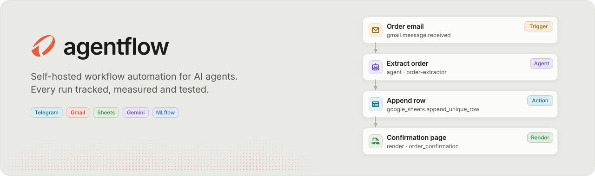
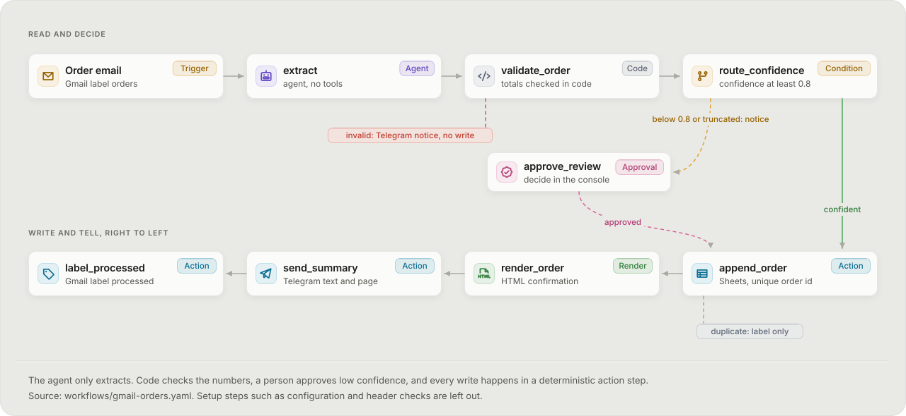
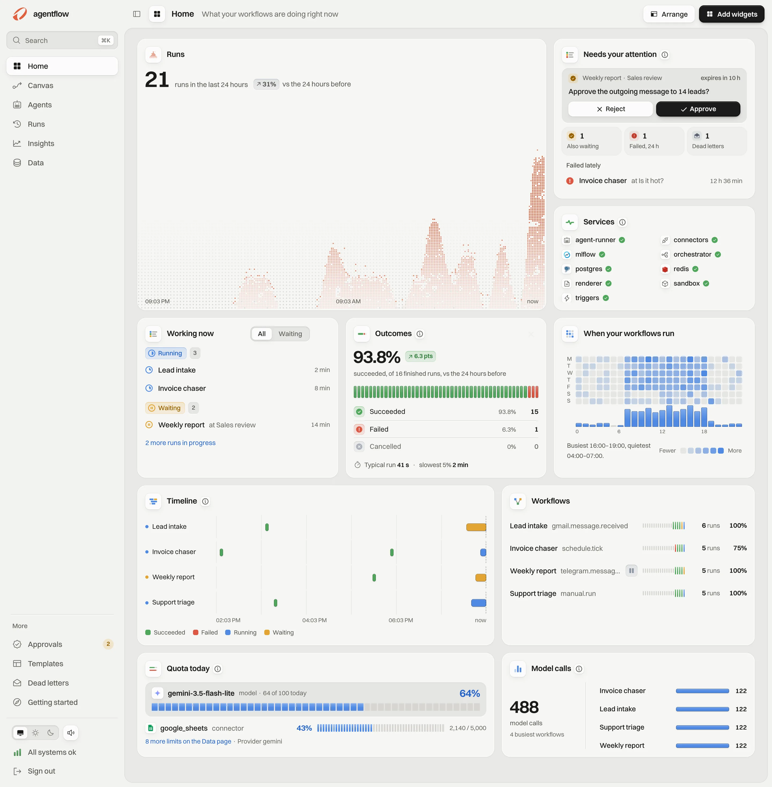
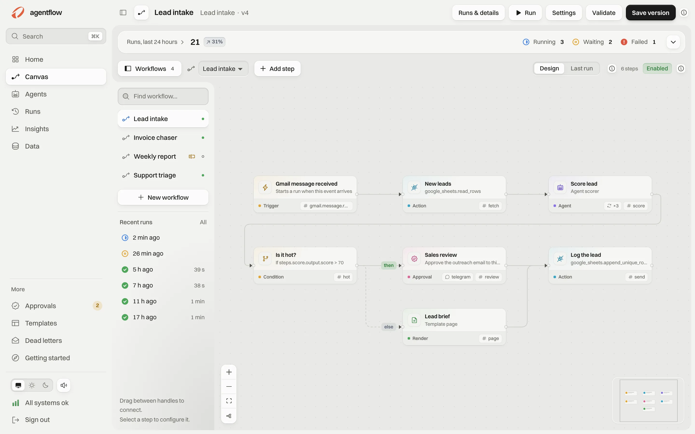
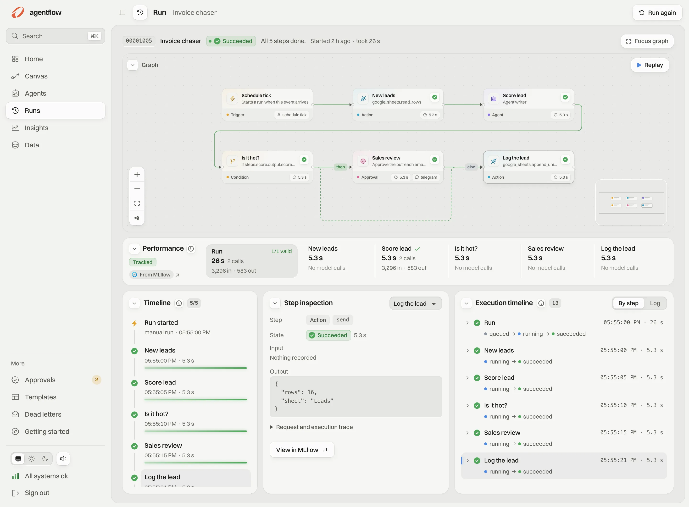
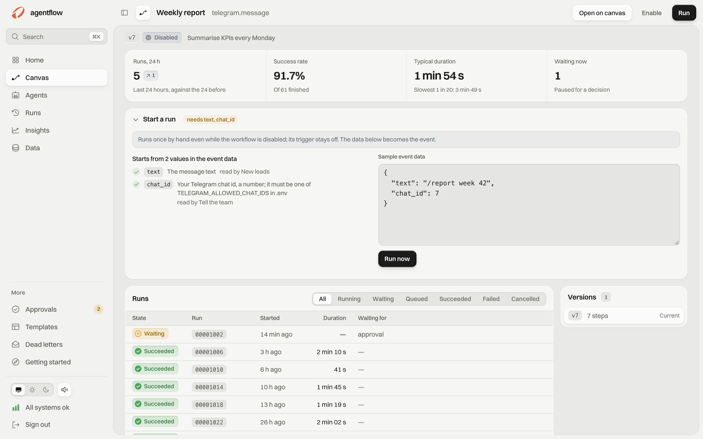
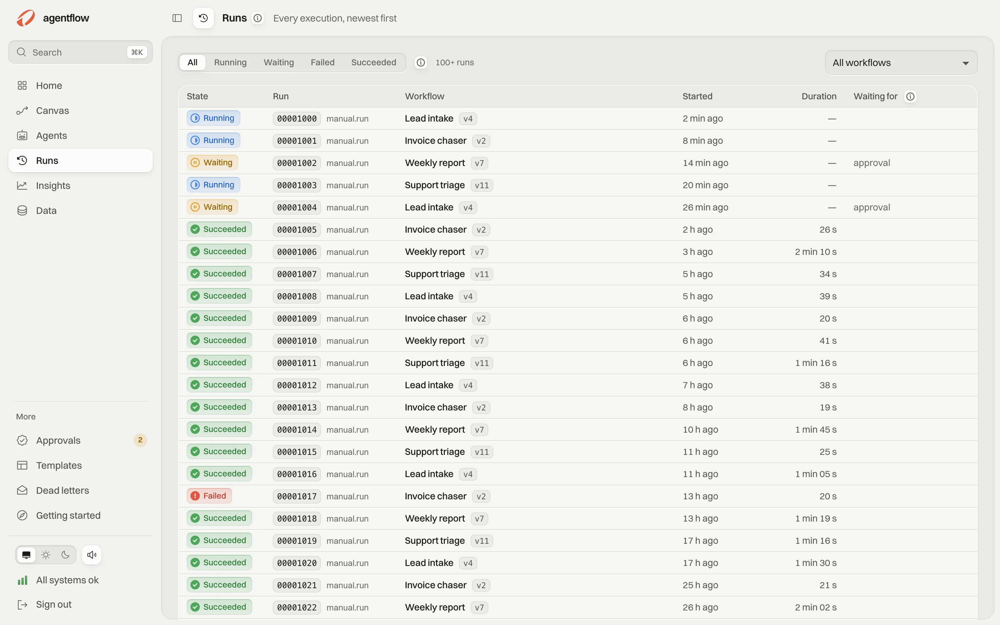
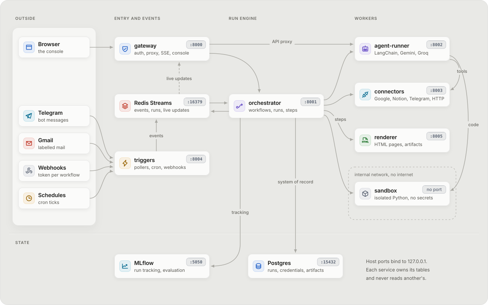
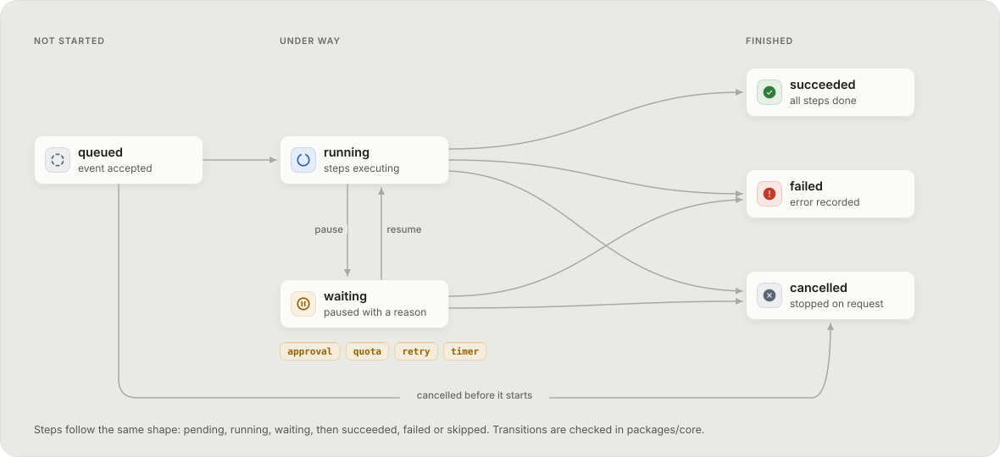

<picture>
  <source media="(prefers-color-scheme: dark)" srcset="diagrams/banner-dark.svg">
  
</picture>

# agentflow

Self-hosted workflow automation for AI agents. A trigger turns something in the outside world into
an event: a Telegram message, a labelled Gmail message, a new Google Sheets row or Drive file, an
upcoming Calendar event, an RSS item, a webhook or a schedule. The event starts a run of a
workflow. The run executes steps in order: LLM agents that extract structured data, code that
checks it, conditions, human approvals, connector actions (Gmail, Google Sheets, Drive, Calendar,
Notion, Telegram, GitHub, any REST API) and a renderer that turns validated data into HTML pages.
Every state change is stored in Postgres and streamed live to a web console; each run is tracked
in MLflow.

**[Open the live demo](https://drissiali221.github.io/agentflow-demo/)**. It is the real console
running in your browser on fictional demo data. Nothing in it calls a real service, so you can
start runs, approve them, replay them and edit workflows freely; everything resets on reload.

This repository holds the demo and this page only. The source code is private and available on
request.

## The flagship flow

An order email arrives under a Gmail label. An agent with no tools extracts the order. Code checks
the arithmetic. A confident order is appended to Google Sheets once, rendered as an HTML
confirmation and sent to Telegram, and the email is labelled processed. A low-confidence or
truncated order sends a Telegram notice and waits for a person to approve it in the console.

<picture>
  <source media="(prefers-color-scheme: dark)" srcset="diagrams/flagship-dark.svg">
  
</picture>

The rule behind it: the LLM extracts, code decides. An email that tries prompt injection can at
worst spoil one extracted record, which validation, the confidence check or a person then stops.
It cannot make the system act.

## The console

<picture>
  <source media="(prefers-color-scheme: dark)" srcset="images/home-dark.webp">
  
</picture>

<table>
  <tr>
    <td width="50%">
      <picture>
        <source media="(prefers-color-scheme: dark)" srcset="images/canvas-dark.webp">
        
      </picture>
      
<b>Canvas.</b> Workflows as a graph of steps, with the workflow library and recent runs.

    </td>
    <td width="50%">
      <picture>
        <source media="(prefers-color-scheme: dark)" srcset="images/run-dark.webp">
        
      </picture>
      
<b>Run detail.</b> Each step's state, timing, input and output, live while the run moves, with replay.

    </td>
  </tr>
  <tr>
    <td width="50%">
      <picture>
        <source media="(prefers-color-scheme: dark)" srcset="images/workflow-dark.webp">
        
      </picture>
      
<b>Workflow.</b> One workflow's figures, and a <b>Start a run</b> form that lists the starting values it reads.

    </td>
    <td width="50%">
      <picture>
        <source media="(prefers-color-scheme: dark)" srcset="images/runs-dark.webp">
        
      </picture>
      
<b>Runs.</b> Every run, newest first, with what a waiting run waits for.

    </td>
  </tr>
</table>

The screenshots and the demo use fictional data only, so no real emails, chats or calendar
entries are published.

## Architecture

<picture>
  <source media="(prefers-color-scheme: dark)" srcset="diagrams/architecture-dark.svg">
  
</picture>

- **Seven FastAPI services** from one template, sharing typed Pydantic contracts from one package:
  gateway, orchestrator, agent-runner, connectors, triggers, renderer and sandbox. Each service
  owns its tables in Postgres and never reads another's.
- **Redis Streams** carry events and run dispatch with consumer groups. A crashed worker's runs
  are reclaimed and resumed from the last completed step.
- **Writes happen once.** Every external write carries an idempotency key per run step and its
  result is stored durably, so a resumed run does not write twice. A write whose outcome is
  unknown after a crash is held for reconciliation instead of being resent.
- **Agents** run on Gemini and Groq behind one fallback chain: a model that fails, is retired or
  runs out of daily quota hands the run to the next one, and quota exhaustion pauses a run instead
  of failing it.
- **The sandbox** runs Python code steps in a fresh process per call, on an internal network with
  no internet, no secrets, a read-only filesystem and CPU, memory and process limits.
- **Security.** Google OAuth with PKCE and minimal scopes, encrypted tokens, an HTTP connector that
  refuses private addresses, and a gateway with key and session admission and rate limits.

A run moves through a small, checked state machine. Waiting always carries a reason.

<picture>
  <source media="(prefers-color-scheme: dark)" srcset="diagrams/run-states-dark.svg">
  
</picture>

## Stack

Python 3.12, FastAPI, Pydantic, SQLAlchemy (async) with Alembic, PostgreSQL 16, Redis 7, MLflow,
LangChain with Gemini and Groq, Docker Compose; React 19, TypeScript, Vite and React Flow for the
console. Tests use pytest, Locust, Vitest and Playwright, including resilience tests that kill
containers mid-run and a load test of 200 webhook events with zero lost or duplicated runs.

## Credits

The console uses [React](https://react.dev), [React Flow](https://reactflow.dev) and
[Phosphor Icons](https://phosphoricons.com) (all MIT) and the
[Switzer](https://www.fontshare.com/fonts/switzer) typeface by Indian Type Foundry (ITF Free Font
License). The diagrams use Phosphor icons.

© 2026 Drissi Ali. All rights reserved for this page and the demo build.
